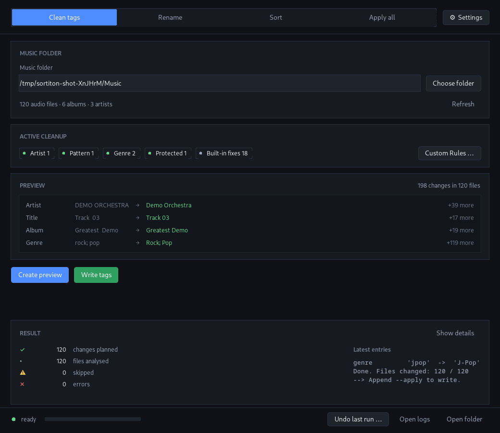

# Sortiton


Sortiton is a music sorter for Linux. It cleans up tags,
renames files based on those tags, and sorts them into a library.
It is the Linux port of one of my earlier PowerShell scripts.



## Features

- **Four operations:** clean tags, rename, sort, and apply all - plus a
read-only export for an LLM.
Each shows a preview first; nothing is written until confirmed.
- **Custom rules without code:** artist and genre corrections are defined in `my_rules.ini`.
- **No overwriting:** if a target name is taken, `(2)`, `(3)`, etc. is appended.
A file already present in the target with identical content is skipped.
- **Journal and undo:** every run is journaled, and `sortiton restore --apply`
reverses it.
- **Idempotent rules:** running them twice yields the same result as running
them once. Genres are not split at `-`, so "J-Pop" stays intact.
- **Few dependencies:** Tkinter and ffmpeg (for tags). mutagen is optional and faster.

## Installation

### Release files

The release files require no installation apart from ffmpeg.

| File | Usage |
| --- | --- |
| `Sortiton-<version>-x86_64.AppImage` | Make executable (`chmod +x`) and run. Requires `libfuse2`. |
| `sortiton-<version>-linux-x86_64.tar.gz` | Unpack and run `Sortiton/Sortiton`. The same folder contains `sortiton`, the command-line tool. |

Both are available under Releases; `SHA256SUMS` lists their checksums.
Tkinter and mutagen are bundled; ffmpeg is not. Logs, backups, `settings.ini`
and `my_rules.ini` are stored in `~/.local/share/sortiton/`.
The `SORTITON_DATA_DIR` variable changes this location.

### From source (Python 3.12 or newer)

```bash
sudo apt install ffmpeg python3-tk        # Debian/Ubuntu
sudo pacman -S ffmpeg tk                  # Arch/Manjaro
sudo dnf install ffmpeg python3-tkinter   # Fedora

sudo apt install python3-mutagen          # optional: faster tag writing
sudo apt install kdialog                  # optional: native KDE dialogs

pipx install "git+https://github.com/Chuu2byou/Sortiton.git"
pipx inject sortiton mutagen              # optional: faster tag writing
```

This installs the commands `sortiton` (command line) and `sortiton-gui`
(graphical interface). `python -m sortiton.gui` is equivalent to the latter.
In a virtual environment, `pip install ".[mutagen]"` includes mutagen.

## Graphical interface

The interface has five tabs: Clean tags, Rename, Sort, Apply all, and Tools.
Each page starts with a short title and one sentence about what it does.
Clean tags, Rename, Sort and Apply all follow the same sequence: create a
preview, review it, then write. The write button remains disabled until a
preview has been run for the current inputs, and it locks again when any input
changes. "Apply all" runs clean tags, rename, and sort in a single pass.

Tools groups the helper features (export reports, apply CSV corrections, fetch
audio) behind a small picker. The form is built from the feature description and
split into cards (folder & files, download, …), a badge says whether the
selected tool reads or writes, and each empty folder field starts with the music
folder. The run button sits next to a one-line note that repeats what will happen.
Only the inputs of a single run stay in the tab: report length, duplicate check
and reader count are fine-tuning and live in the settings (the gear button or
"Fine-tuning …" below the form). Those values are stored in `settings.ini` and
are used again on the next start.

`Ctrl+1` … `Ctrl+5` switch tabs; every button can also be reached with the
keyboard (`Tab`, then `Enter` or `Space`).

The status bar shows the current step and progress.
The result area shows the counters of the last run alongside the newest log lines;
"Show details" opens the full log. Folder pickers use the native system dialog
(kdialog on KDE, zenity on GNOME), with Tkinter as a fallback.

Fonts, paddings and control sizes follow the screen resolution automatically.
`SORTITON_UI_SCALE=1.25` (or `1.5`, …) overrides the detected factor; the
settings window shows the value in use.

Before writing, a confirmation dialog shows the counts and offers a backup of
the original files. "Undo last run …" lists the journals and shows the plan
before anything is changed.

## Command line

Without `--apply`, every command runs as a preview only. Nothing is changed.

```bash
sortiton tags   ~/Downloads/Music              # clean tags (in-place)
sortiton tags   ~/Downloads/Music ~/Music --move --apply  # clean tags and sort
sortiton rename ~/Downloads/Music --apply      # %artist% - %title% (in-place)
sortiton rename ~/Downloads/Music ~/Music --move --apply  # rename and sort
sortiton sort   ~/Downloads/Music ~/Music --move --apply
sortiton all    ~/Downloads/Music ~/Music --move --apply
sortiton scan   ~/Music                        # count files/albums/artists
sortiton export ~/Music                        # write reports for an LLM
sortiton fetch  URL ~/Music --apply --confirm  # download audio (yt-dlp)
sortiton rules  --template                     # create my_rules.ini
sortiton restore --list                        # list runs that can be undone
sortiton restore --apply                       # undo the last run
```

In the source tree, the same commands run as `python3 sortiton.py …`.

Placeholders for file names: `%artist%`, `%albumartist%`, `%album%`, `%title%`.
The default is `%artist% - %title%`.

## Export for an LLM

`sortiton export ~/Music` reads the folder and writes a set of reports for a
large language model: `00_prompt.md` (the instruction to the model),
`01_zusammenfassung.md` (statistics), `02_auffaelligkeiten.md` (anomalies) and
one `tracks_partNN.tsv` per chunk. `--fingerprint` adds `03_duplikate.md` and
needs `fpcalc`; `--jsonl` adds `alle_tags.jsonl` with the raw tags.

The export only reads the library - it never changes a file, so there is no
`--apply`. The reports go to `SORTITON_EXPORT_DIR` (default `exports/` in the
project folder), the fingerprint cache to `SORTITON_CACHE_DIR` (default
`cache/`).

## Download audio (`fetch`)

`sortiton fetch URL FOLDER` previews a video or playlist with `yt-dlp` and
reports what it would find. Downloading needs both `--apply` and `--confirm`;
`yt-dlp` must be on the `PATH`. Only download content you have the rights to.

Downloads often carry junk tags such as "Official Video" or the uploader name.
Sortiton does not clean them during the download, so fetch first and run the
usual cleanup on the target folder afterwards:

```bash
sortiton fetch  URL ~/Downloads/Music --apply --confirm
sortiton tags   ~/Downloads/Music --apply   # built-in cleanups, my_rules.ini
sortiton rename ~/Downloads/Music --apply   # %artist% - %title%
sortiton sort   ~/Downloads/Music ~/Music --move --apply
```

Every step previews first and only writes with `--apply` (`fetch` also needs
`--confirm`). `sortiton tags` applies the built-in cleanups and your
`my_rules.ini` rules; the read-only `sortiton export ~/Downloads/Music` lists
what still looks like junk in `02_auffaelligkeiten.md`.

The "Apply all" pipeline can run the same sequence in one pass: add
`--fetch-url URL` and `--fetch-confirmed` (and `--apply` for the run) and the
download happens before clean tags, rename and sort on the same source folder:

```bash
sortiton all ~/Downloads/Music ~/Music --move --apply \
    --fetch-url URL --fetch-confirmed
```

## Custom rules (`my_rules.ini`)

Artist names and other collection-specific corrections belong in `my_rules.ini`
rather than in the code. The file is read on every run.

```ini
[Artist]                   # custom spellings (case-insensitive)
Sample Band = Sample Band Official

[Artist Regex]             # regular expressions; groups such as \1 work
(?i)\bsample\s+band\b = Sample Band

[Genre]                    # unify spellings; an empty value deletes the genre
synthpop = Synth-Pop
junkgenre =

[Protected]                # left unchanged and never split
Example & Co
Foo/Bar = Foo / Bar
```

- **Create:** `sortiton rules --template`, or "Custom Rules …" in the GUI.
- **Check:** `sortiton rules` shows the path, the loaded rules, and any warnings.
A malformed line is skipped and does not abort the run.
- **Built-in rules:** `sortiton rules --builtin` lists them (for example,
genre aliases such as `jpop = J-Pop`, and structural fixes such as
collapsing repeated spaces). They are always active and applied before custom rules.
- Names containing `&`, `/`, or `,` are never split.
- Alternative location: `SORTITON_RULES`.

## Logs, backup, and undo

Every run, in the GUI or on the command line, writes a log file to `logs/`
(`sortiton_<date>_<time>.log`; the last 50 are kept) and a machine-readable
journal alongside it.

Before tags are written, each file about to change can be copied to `backups/`,
with relative paths preserved so that restoring is a plain copy. This option is
on by default, can be toggled in the confirmation dialog, and is stored in
`settings.ini`. On the command line, use `--backup`. The last 10 runs are kept.
`sortiton restore` reads the journal and reverses the changes, newest first. A
combined run (tags → rename → sort) is therefore undone as sort → rename → tags.

```bash
sortiton restore --list            # list runs that can be undone
sortiton restore                   # preview the undo
sortiton restore --apply           # perform the undo
```

A step whose original name is occupied again is skipped, never overwritten.
For a run that copied files, the copies are deleted and the originals remain.
Downloads werden nur gelöscht, wenn ihr Inhalt noch dem SHA-256-Fingerabdruck
im Journal entspricht. Veränderte Dateien und ältere Download-Einträge ohne
Fingerabdruck bleiben ebenso wie ihre Archiv-IDs erhalten.
As with other commands, nothing changes without `--apply`. `restore` writes its
own journal, so an undo remains traceable. `SORTITON_JOURNAL=false`
disables the journal.

Tags are read with mutagen if installed (about 1.8 ms per file) and written in
place; ffprobe/ffmpeg is the fallback. Reading, writing, and copying run in parallel.

## Environment variables

| Variable | Meaning |
| --- | --- |
| `SORTITON_DATA_DIR` | Data folder of the released app (`~/.local/share/sortiton`) |
| `SORTITON_RULES` | Path to `my_rules.ini` |
| `SORTITON_LOG_DIR` | Folder for log files |
| `SORTITON_BACKUP_DIR` | Folder for backups |
| `SORTITON_SETTINGS` | Path to `settings.ini` |
| `SORTITON_EXPORT_DIR` | Folder for the export reports |
| `SORTITON_CACHE_DIR` | Folder for the fingerprint cache |
| `SORTITON_BACKUP` | `false` disables the backup |
| `SORTITON_JOURNAL` | `false` disables the run journal (restore then has nothing to work with) |
| `SORTITON_FOLDER` / `SORTITON_TARGET` | Start folders of the GUI |
| `SORTITON_UI_SCALE` | UI scale of the GUI, e.g. `1.25` (default: screen DPI) |

## Contributing

Bug reports and pull requests go through the issue tracker.
Before submitting a patch, run both of the following:

```bash
tools/checks.sh       # syntax, imports, pytest, pylint, CLI
tools/build_app.sh    # freeze the program (tar.gz, --appimage)
```

`CONTRIBUTING.md` describes the project layout, what the checks do,
and how a release is made.

## License

MIT. See `LICENSE`.
