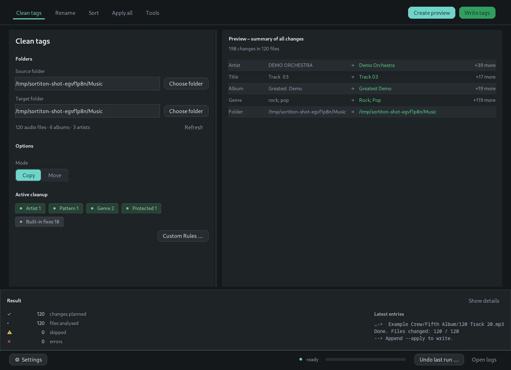

# Sortiton


Sortiton organises music on Linux: it cleans tags, renames files, and sorts them
into a library.



## Features

- Clean tags, rename files, and sort music, individually or together.
- Preview changes before applying them; undo runs when needed.
- Define artist and genre corrections in `my_rules.ini`.
- Find duplicates, apply CSV corrections, and export reports for an LLM.
- Avoid overwriting files: conflicting names get a numbered suffix; identical
  files are skipped.

## Installation

### Release files

The release files require no installation apart from ffmpeg.

| File | Usage |
| --- | --- |
| `Sortiton-<version>-x86_64.AppImage` | Make executable (`chmod +x`) and run. Requires `libfuse2`. |
| `sortiton-<version>-linux-x86_64.tar.gz` | Unpack and run `Sortiton/Sortiton`. The same folder contains `sortiton`, the command-line tool. |

Both are available under Releases; `SHA256SUMS` lists their checksums.
Tkinter and mutagen are bundled; ffmpeg is not. Logs, backups, `settings.ini`
and `my_rules.ini` are stored in `~/.local/share/sortiton/`.
The `SORTITON_DATA_DIR` variable changes this location.

### From source (Python 3.12 or newer)

```bash
sudo apt install ffmpeg python3-tk        # Debian/Ubuntu
sudo pacman -S ffmpeg tk                  # Arch/Manjaro
sudo dnf install ffmpeg python3-tkinter   # Fedora

sudo apt install python3-mutagen          # optional: faster tag writing
sudo apt install kdialog                  # optional: native KDE dialogs

pipx install "git+https://github.com/Chuu2byou/Sortiton.git"
pipx inject sortiton mutagen              # optional: faster tag writing
```

This installs the commands `sortiton` (command line) and `sortiton-gui`
(graphical interface). `python -m sortiton.gui` is equivalent to the latter.
In a virtual environment, `pip install ".[mutagen]"` includes mutagen.

## Command line

Without `--apply`, every command runs as a preview only. Nothing is changed.

```bash
sortiton tags   ~/Downloads/Music              # clean tags (in-place)
sortiton tags   ~/Downloads/Music ~/Music --move --apply  # clean tags and sort
sortiton rename ~/Downloads/Music --apply      # %artist% - %title% (in-place)
sortiton rename ~/Downloads/Music ~/Music --move --apply  # rename and sort
sortiton sort   ~/Downloads/Music ~/Music --move --apply
sortiton all    ~/Downloads/Music ~/Music --move --apply
sortiton scan   ~/Music                        # count files/albums/artists
sortiton export ~/Music                        # write reports for an LLM
sortiton fixes  changes.csv --root ~/Music     # preview CSV corrections
sortiton dedupe ~/Music                        # preview exact duplicates
sortiton dedupe ~/Music --apply                # move them to .duplicates
sortiton rules  --template                     # create my_rules.ini
sortiton restore --list                        # list runs that can be undone
sortiton restore --apply                       # undo the last run
```

In the source tree, the same commands run as `python3 sortiton.py …`.

Placeholders for file names: `%artist%`, `%albumartist%`, `%album%`, `%title%`.
The default is `%artist% - %title%`.

Use `sortiton --help` or `sortiton <command> --help` for all options. For example,
`--track-format` controls track and disc number formatting, and `--diff` shows
tag changes.

## Export for an LLM

`sortiton export ~/Music` creates reports and track lists for a large language
model, by default in `~/Downloads/Sortiton`. The export does not change music
files. Use `--fingerprint` for duplicate reports (requires `fpcalc`) or `--jsonl`
for raw tags.

## Find duplicates (`dedupe`)

`sortiton dedupe ~/Music` scans a folder and previews which files it would
move. Nothing is deleted: every duplicate is moved into a hidden
`.duplicates/` folder below the scanned root, with its relative path preserved.
The next scan ignores that folder automatically.

```bash
sortiton dedupe ~/Music                 # preview
sortiton dedupe ~/Music --apply         # move the duplicates
sortiton restore                        # preview the undo
sortiton restore --apply                # move them back
```

By default, only byte-for-byte identical files are considered duplicates.
`--by tags` also matches artist, title, album, and duration; it requires mutagen
or ffprobe and can group different recordings. Review the preview carefully.

The same feature is available in the GUI under Tools → Duplicates.

## Custom rules (`my_rules.ini`)

Artist names and other collection-specific corrections belong in `my_rules.ini`
rather than in the code. The file is read on every run.

```ini
[Artist]                   # custom spellings (case-insensitive)
Sample Band = Sample Band Official

[Artist Regex]             # regular expressions; groups such as \1 work
(?i)\bsample\s+band\b = Sample Band

[Genre]                    # unify spellings; an empty value deletes the genre
synthpop = Synth-Pop
junkgenre =

[Protected]                # left unchanged and never split
Example & Co
Foo/Bar = Foo / Bar
```

- Create a template with `sortiton rules --template`, or use "Custom Rules …"
  in the GUI.
- Run `sortiton rules` to check loaded rules and warnings; use `--builtin` to
  list built-in rules.
- Use `[Protected]` to keep names containing separators together. Protected
  names take precedence over `[Artist]` rules; use `K/DA = K／DA` in
  `[Protected]` to also change the spelling.

## Logs, backup, and undo

Runs create logs and journals in `logs/`. Backups before tag changes are enabled
by default in the GUI; on the command line, use `--backup`. Restore uses the
journal to reverse changes, including duplicate moves.

```bash
sortiton restore --list            # list runs that can be undone
sortiton restore                   # preview the undo
sortiton restore --apply           # perform the undo
```

## Environment variables

| Variable | Meaning |
| --- | --- |
| `SORTITON_DATA_DIR` | Data folder of the released app (`~/.local/share/sortiton`) |
| `SORTITON_RULES` | Path to `my_rules.ini` |
| `SORTITON_LOG_DIR` | Folder for log files |
| `SORTITON_BACKUP_DIR` | Folder for backups |
| `SORTITON_SETTINGS` | Path to `settings.ini` |
| `SORTITON_EXPORT_DIR` | Folder for the export reports |
| `SORTITON_CACHE_DIR` | Folder for the fingerprint cache |
| `SORTITON_BACKUP` | `false` disables the backup |
| `SORTITON_JOURNAL` | `false` disables the run journal (restore then has nothing to work with) |
| `SORTITON_FOLDER` / `SORTITON_TARGET` | Start folders of the GUI |
| `SORTITON_UI_SCALE` | UI scale of the GUI, e.g. `1.25` (default: screen DPI) |

## Contributing

Bug reports and pull requests go through the issue tracker.
Before submitting a patch, run both of the following:

```bash
tools/checks.sh       # syntax, imports, pytest, pylint, CLI
tools/build_app.sh    # freeze the program (tar.gz, --appimage)
```

`CONTRIBUTING.md` describes the project layout, what the checks do,
and how a release is made.

## License

MIT. See `LICENSE`.
